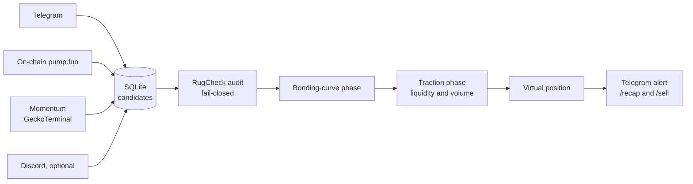

# Memecoin Watcher — pump.fun (Solana)

*[English version](README.md)*

   

Un watcher d'**observation uniquement** pour les memecoins Solana lancés sur **pump.fun**. Plusieurs détecteurs indépendants repèrent les tokens nouveaux ou en mouvement rapide, un audit anti-scam les filtre, puis un cycle de confirmation en deux phases suit chaque survivant jusqu'à l'ouverture d'une position **virtuelle**, signalée sur Telegram.

> **Projet éducatif — rien n'est jamais acheté.** Aucune clé privée, aucun wallet Solana, aucun fonds en jeu ; les positions sont simulées. Le sniping de memecoins est une activité à très haut risque (la quasi-totalité de ces tokens finit à zéro), et ce constat guide chaque seuil et chaque filtre ci-dessous.

## Architecture en un coup d'œil



## Points forts techniques

- **Fail-closed par conception.** Si le rapport d'audit est absent, mal formé ou l'API en panne, un token n'avance jamais : le watcher ne fait rien progresser à l'aveugle.
- **Des détecteurs indépendants.** Chaque source tourne en tâche asyncio isolée : un flux en panne n'emporte pas les autres.
- **La patience comme filtre.** Un token doit montrer une vraie croissance de liquidité et de volume après migration avant l'ouverture d'une position virtuelle.
- **Ni fonds ni clés.** Observation seule, 240+ tests, secrets confinés à des fichiers ignorés par git.

## Fonctionnement

```
détecteurs ──► candidats (SQLite) ──► audit sécurité ──► phase courbe ──► phase post-migration ──► position virtuelle + alerte Telegram
```

| Étape | Ce qui se passe |
| --- | --- |
| **Détection** | Quatre détecteurs indépendants, en tâches asyncio isolées : **Telegram** (lit des channels d'alpha avec un compte utilisateur et en extrait les adresses de tokens Solana), **on-chain** (interroge l'API pump.fun des nouveaux tokens), **momentum** (pools tendance GeckoTerminal : accélération rapide du prix et du volume sur tout le marché Solana) et un bot **Discord** facultatif |
| **Audit sécurité** | Rapport [RugCheck.xyz](https://rugcheck.xyz), **fail-closed** : un candidat est bloqué si l'autorité de mint ou de freeze est encore active, si le plus gros holder dépasse `MAX_TOP_HOLDER_PERCENT`, ou si le rapport est indisponible ou mal formé |
| **Phase courbe** | Suit la progression de la bonding curve pump.fun jusqu'à la migration vers un pool PumpSwap |
| **Phase traction** | Après migration, observe le pool pendant `TRACTION_WINDOW_MINUTES` et exige une vraie croissance de liquidité (`TRACTION_LIQUIDITY_MULT`) et de volume sur 1 h (`TRACTION_MIN_VOLUME_USD`) sur DexScreener avant d'ouvrir une position virtuelle — sniper à la seconde 0 est presque toujours perdant, la liquidité étant retirée en quelques minutes |
| **Suivi** | Alertes Telegram quand la traction est confirmée, plus les commandes `/recap` (état des lieux) et `/sell` (clôturer une position virtuelle) en long polling — pas de webhook, aucun port exposé |

## Organisation du projet

```
main.py                          point d'entrée : lance les détecteurs et le cycle de confirmation
watcher/
  config.py                      chargement de l'environnement avec validation fail-fast
  storage.py                     persistance SQLite (candidats, positions virtuelles, heartbeat)
  security_check.py              audit RugCheck (fail-closed)
  quotes.py                      cotations Solana en deux phases (bonding curve, pools DexScreener)
  notifier.py                    alertes Telegram
  command_listener.py            commandes /recap et /sell
  detectors/                     telegram, on-chain, momentum, discord + extraction commune des messages
deploy/                          exemple d'unité systemd
tests/                           240+ tests
```

## Démarrage

```bash
python -m venv .venv && source .venv/bin/activate     # Windows : .venv\Scripts\Activate.ps1
pip install -r requirements.txt                       # requirements-dev.txt ajoute pytest
cp .env.example .env                                  # identifiants API Telegram (my.telegram.org), channels, seuils
python main.py --listen                               # lance détecteurs + cycle de confirmation
pytest                                                # lancer les tests
```

Sans `--listen`, `main.py` n'affiche que l'aide : il n'existe volontairement pas de mode « acheter ce token maintenant ».

## Sécurité opérationnelle

- Aucune clé privée ni wallet n'est nécessaire dans cette phase ; le watcher se contente d'observer.
- Les identifiants API Telegram et le fichier de session Telethon vivent uniquement dans `.env` et des fichiers locaux ignorés par git — ne les commite jamais. Un fichier de session équivaut à un mot de passe de compte.
- Les noms de champs JSON de RugCheck suivent le format documenté au moment de l'écriture ; à vérifier sur une vraie réponse avant de s'y fier, un schéma tiers pouvant changer.
