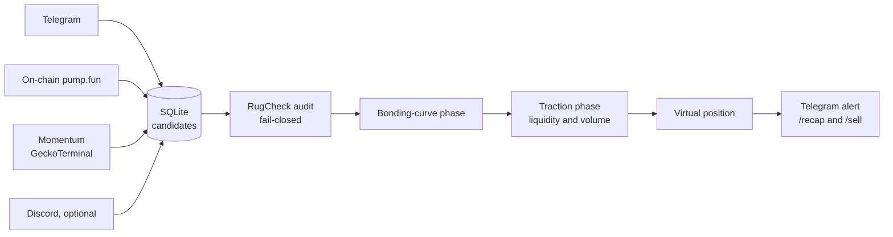

# Memecoin Watcher — pump.fun (Solana)

*[Version française](README.fr.md)*

   

An **observation-only** watcher for Solana memecoins launched on **pump.fun**. Several independent detectors spot new or fast-moving tokens, an anti-scam audit filters them, and a two-phase confirmation cycle tracks each survivor until a **virtual** position is opened and reported on Telegram.

> **Educational project — nothing is ever bought.** No private key, no Solana wallet and no funds are involved; positions are simulated. Memecoin sniping is a very high-risk activity (nearly all of these tokens end at zero), and that observation drives every threshold and filter below.

## Architecture at a glance



## Engineering highlights

- **Fail-closed by design.** If the audit report is missing, malformed or the API is down, a token never moves forward: the watcher never advances anything blind.
- **Independent detectors.** Each source runs as an isolated asyncio task, so one failing feed cannot take the others down.
- **Patience as a filter.** A token must show real liquidity growth and volume after migration before a virtual position is opened.
- **No funds, no keys.** Observation only, with 240+ tests and secrets confined to git-ignored files.

## How it works

```
detectors ──► candidates (SQLite) ──► security audit ──► bonding-curve phase ──► post-migration phase ──► virtual position + Telegram alert
```

| Stage | What happens |
| --- | --- |
| **Detection** | Four independent detectors run as isolated asyncio tasks: **Telegram** (reads alpha channels with a user account and extracts Solana token addresses), **on-chain** (polls pump.fun's new-token API), **momentum** (GeckoTerminal trending pools: fast price + volume acceleration across the whole Solana market) and an optional **Discord** bot |
| **Security audit** | [RugCheck.xyz](https://rugcheck.xyz) report, **fail-closed**: a candidate is blocked if the mint or freeze authority is still active, if the top holder exceeds `MAX_TOP_HOLDER_PERCENT`, or if the report is unavailable or malformed |
| **Curve phase** | Follows the pump.fun bonding-curve progress until the token migrates to a PumpSwap pool |
| **Traction phase** | After migration, watches the pool for `TRACTION_WINDOW_MINUTES` and requires real liquidity growth (`TRACTION_LIQUIDITY_MULT`) and 1-hour volume (`TRACTION_MIN_VOLUME_USD`) on DexScreener before opening a virtual position — sniping at second zero almost always loses, because liquidity is pulled within minutes |
| **Reporting** | Telegram alerts when traction is confirmed, plus on-demand `/recap` (state of play) and `/sell` (close a virtual position) commands via long polling — no webhook, no exposed port |

## Project layout

```
main.py                          entry point: starts the detectors and the confirmation cycle
watcher/
  config.py                      environment loading with fail-fast validation
  storage.py                     SQLite persistence (candidates, virtual positions, heartbeat)
  security_check.py              RugCheck audit (fail-closed)
  quotes.py                      Solana quotes in two phases (bonding curve, DexScreener pools)
  notifier.py                    Telegram alerts
  command_listener.py            /recap and /sell commands
  detectors/                     telegram, on-chain, momentum, discord + shared message parsing
deploy/                          example systemd unit
tests/                           240+ tests
```

## Getting started

```bash
python -m venv .venv && source .venv/bin/activate     # Windows: .venv\Scripts\Activate.ps1
pip install -r requirements.txt                       # requirements-dev.txt adds pytest
cp .env.example .env                                  # Telegram API credentials (my.telegram.org), channels, thresholds
python main.py --listen                               # start detectors + confirmation cycle
pytest                                                # run the tests
```

Without `--listen`, `main.py` only prints its help: there is deliberately no "buy this token now" mode.

## Operational safety

- No private key or wallet is needed in this phase; the watcher only observes.
- Telegram API credentials and the Telethon session file live only in `.env` / local files that are git-ignored — never commit them. A session file is equivalent to an account password.
- RugCheck JSON field names follow the documented format at the time of writing; check them against a real response before relying on it, since a third-party schema can change.
